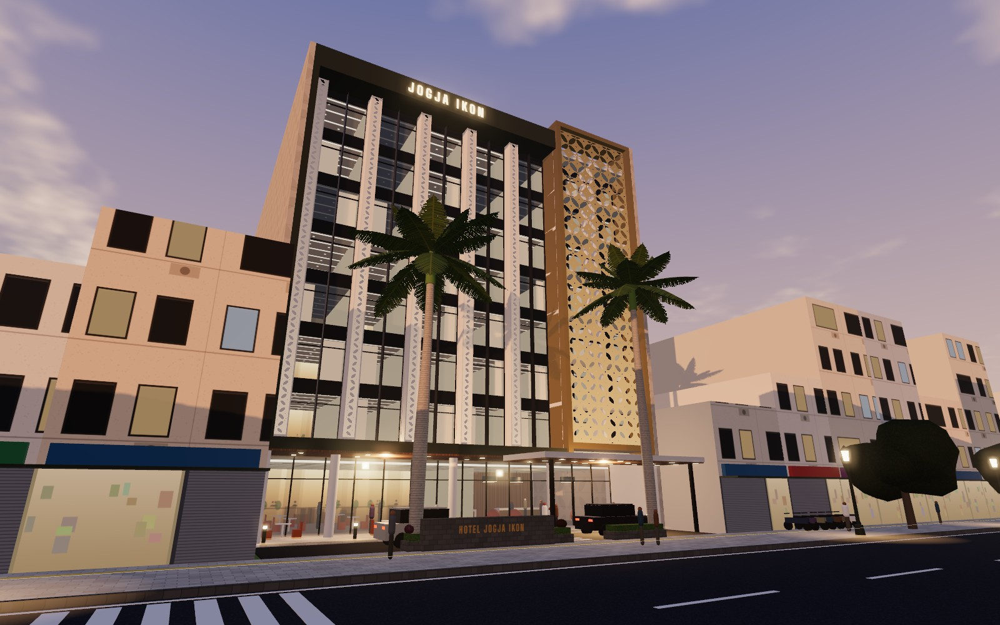
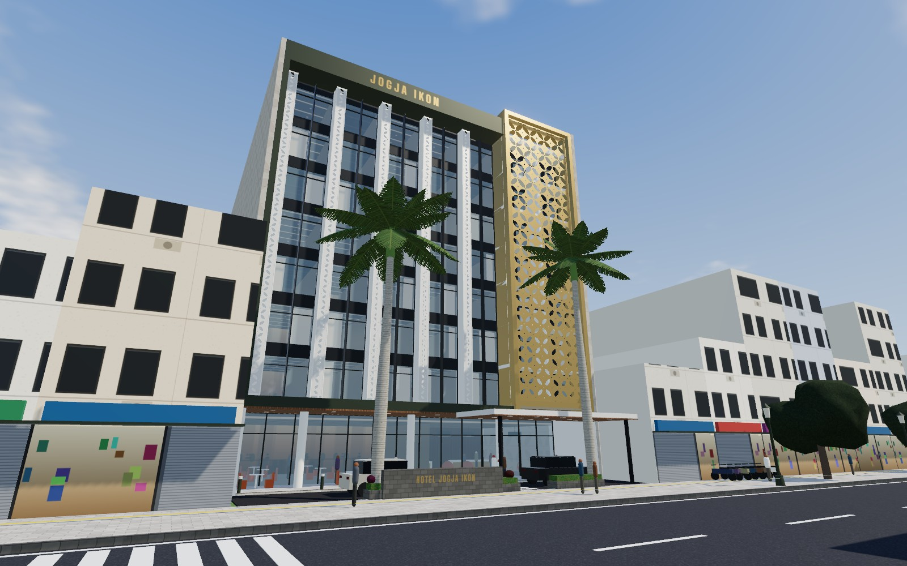
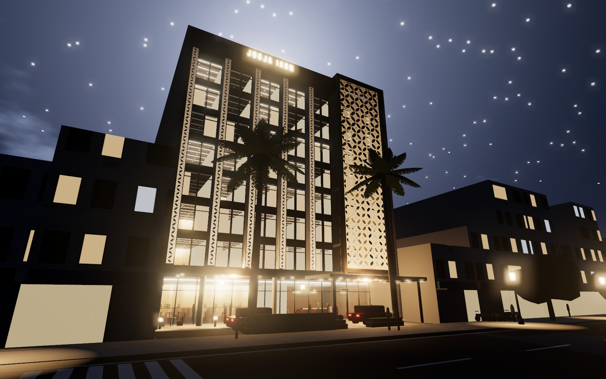
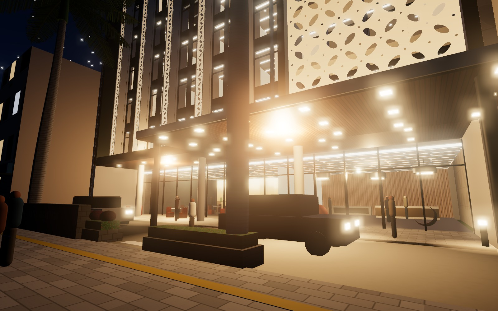
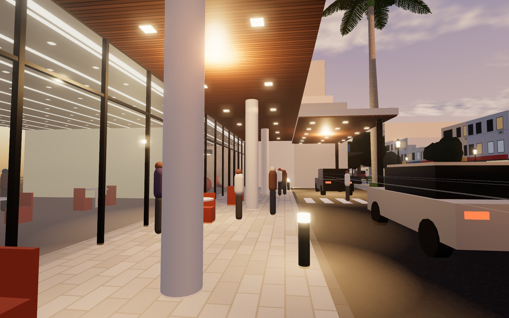
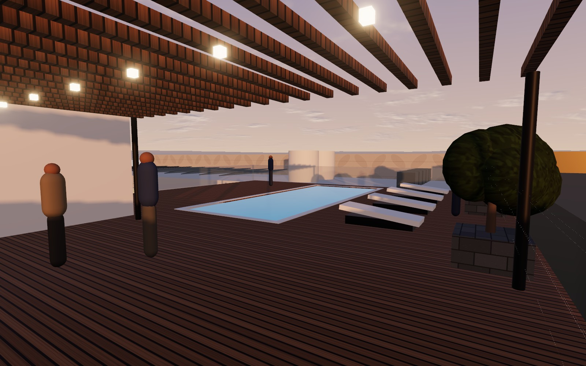
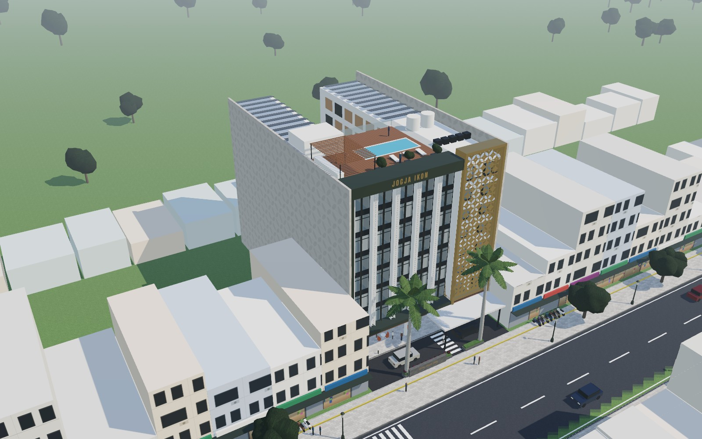
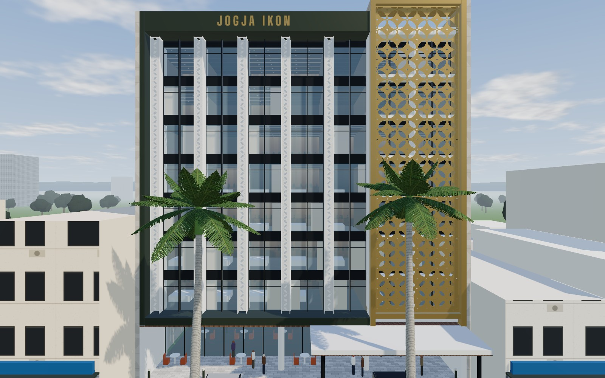
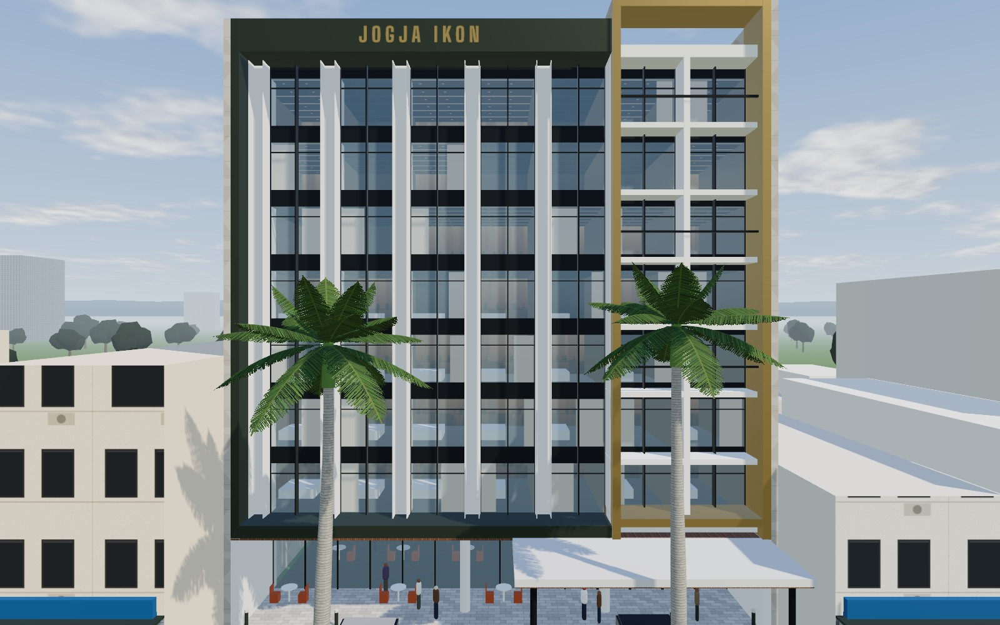

# Hotel Jogja Ikon, Konsep Kawung

Konsep arsitektur 3D untuk hotel 8 lantai dengan 134 kamar di kavling kota 1.300 m² di Yogyakarta. Kiri dan kanan kavling berbatasan langsung dengan bangunan tetangga, jadi hotel hanya punya satu muka, yaitu fasad depan. Bahasa arsitektur gambar referensi (bingkai gelap, sirip putih berlubang, panel emas berpola, kanopi tipis, lampu interior hangat) dipadatkan ke fasad selebar 26 m itu.

## Membuka model

Buka `index.html` di browser modern (Chrome, Edge, Firefox, Safari). Model dibangun secara prosedural dengan Three.js r169 yang dimuat dari jsDelivr, jadi perlu koneksi internet. Tidak ada langkah build.

- **Waktu:** Siang, Senja, Malam.
- **Kamera:** Sudut jalan, Drop-off, Teras, Atap, Udara, Tampak depan.
- **Toggle:** Kulit kawung (lepas untuk melihat loggia di baliknya), Lansekap, Label, Putar otomatis.
- **Catatan desain:** data proyek, program, tipe kamar, tata lantai, fasad, sirkulasi, material.

## Data proyek

| | |
|---|---|
| Luas tanah | 1.300 m² (asumsi muka 26 m × kedalaman 50 m) |
| Luas bangunan | ±6.650 m² di model (target 6.600 m²) |
| Jumlah lantai | 8 |
| Jumlah kamar | 134 |
| KDB | ±80% (lantai dasar 1.040 m²) |
| KLB | ±5,1 |
| Tinggi puncak | ±30,6 m (lantai dasar 5,0 m, lantai kamar 3,3 m) |

## Gagasan

- **Satu muka, satu ikon.** Lima kolom kamar dibingkai bingkai hijau zaitun gelap dengan mahkota "JOGJA IKON" yang menjorok 2,0 m. Dua kolom kanan ditutup kulit kawung emas 6,8 × 24,6 m yang berdiri 1,8 m di depan kaca. Kulit ini menjadi ikon hotel: panel emas di siang hari, lampion raksasa di malam hari. Bukaan perforasinya bertahap dari ±17% di bawah hingga ±45% di puncak.
- **Dinding samping masif.** Dinding kiri dan kanan tanpa bukaan, sesuai aturan dinding batas kavling. Bagian yang menjulang di atas atap tetangga diberi plester bertekstur dengan relief kawung dangkal.
- **Massa U di atas podium.** Lantai 2 sampai 8 berbentuk U: blok depan 26 × 16,2 m, dua sayap 8 m menempel dinding batas, dan taman dalam 10 × 23,8 m di atas atap lantai dasar. Semua kamar yang tidak menghadap jalan mendapat cahaya dari taman ini.

## Program per lantai

| Elevasi | Isi | Luas |
|---|---|---|
| ±0,00 | Lobi dan resepsionis, lounge, restoran all-day dining dengan teras, dapur, back-of-house | 1.040 m² |
| +5,00 | 14 kamar, 2 ruang meeting, gym, taman dalam | ±802 m² |
| +8,30 s.d. +24,80 | 6 lantai kamar tipikal, 20 kamar per lantai | ±802 m² per lantai |
| +28,60 | Kolam renang, sky bar, ruang mesin lift, tandon, panel surya di atap sayap | – |

## Kamar (134)

| Tipe | Ukuran | Jumlah |
|---|---|---|
| Deluxe menghadap jalan | 3,6 × 7,2 m (±26 m²), 14 di antaranya dengan loggia di balik kulit kawung | 49 (7 per lantai, L2–L8) |
| Family menghadap taman | 5,0 × 7,2 m (±36 m²) | 12 (2 per lantai, L3–L8) |
| Superior menghadap taman | 3,6 × 6,4 m (±23 m²) | 73 (11 per lantai di L3–L8, 7 di L2) |

Inti utama (2 lift tamu dan tangga) ada di pertemuan sayap kiri. Lift servis, linen, dan tangga darurat ada di pertemuan sayap kanan. Tangga darurat kedua ada di ujung sayap kiri. Koridor sayap menempel dinding batas.

## Sirkulasi dan parkir

- Halaman depan sedalam 8 m berupa jalur satu arah: masuk dari kiri, turun di porte-cochère, keluar di kanan, searah lalu lintas lajur kiri.
- Pejalan kaki masuk dari tengah lewat penyeberangan bermarka di jalur drop-off.
- Kavling tidak cukup untuk parkir mobil 134 kamar di permukaan. Perlu basement atau valet ke lahan parkir lain. Keduanya belum dimodelkan.
- Bongkar muat dan servis perlu akses belakang atau jadwal khusus di halaman depan, tergantung kondisi tapak sebenarnya.

## Material

| Elemen | Material |
|---|---|
| Bingkai dan mahkota | Aluminium komposit hijau zaitun gelap |
| Kulit kawung | Aluminium anodized champagne, perforasi CNC |
| Sirip fasad | Aluminium perforasi putih |
| Kaca | Laminated low-E, tint netral |
| Dinding samping | Plester bertekstur dengan relief kawung dangkal |
| Pot tanaman, dinding nama | Batu andesit |
| Plafon teras dan porte-cochère, dinding lobi, dek kolam | Kayu jati |
| Interior (dari referensi kedua) | Lacquer hitam, putih doff berpanel anyaman kuningan, kursi oranye bata, lampu gantung drum |

## Render

| | |
|---|---|
|  |  |
| Siang, sudut jalan | Malam, sudut jalan |
|  |  |
| Porte-cochère dan lobi, malam | Teras restoran, senja |
|  |  |
| Kolam dan sky bar di atap, senja | Udara: massa U, dinding samping, tetangga |
|  |  |
| Tampak depan | Kulit kawung dilepas, loggia kamar terlihat |

Render diambil dari model yang sama (Chromium headless, SwiftShader), jadi kualitasnya setara tampilan di browser, bukan render fotorealistik.

## Catatan

Model konsep berskala. Ukuran kavling 26 × 50 m adalah asumsi dan perlu disesuaikan dengan ukuran sebenarnya. KDB, KLB, batas ketinggian, GSB, dinding batas, dan kebutuhan parkir perlu diverifikasi terhadap RDTR dan peraturan Kota Yogyakarta, serta standar operator hotel. Papan nama final sebaiknya disertai aksara Jawa sesuai kebiasaan penanda bangunan di Yogyakarta.
