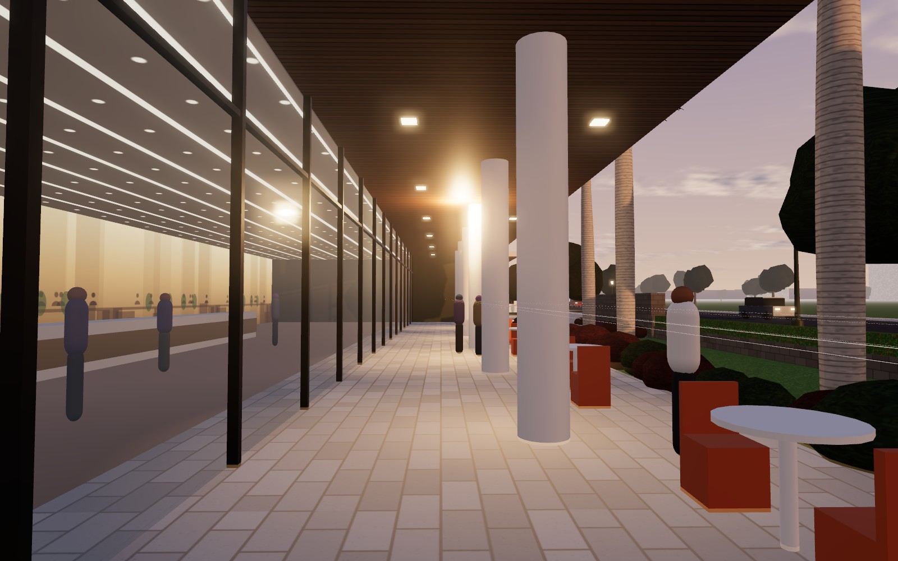
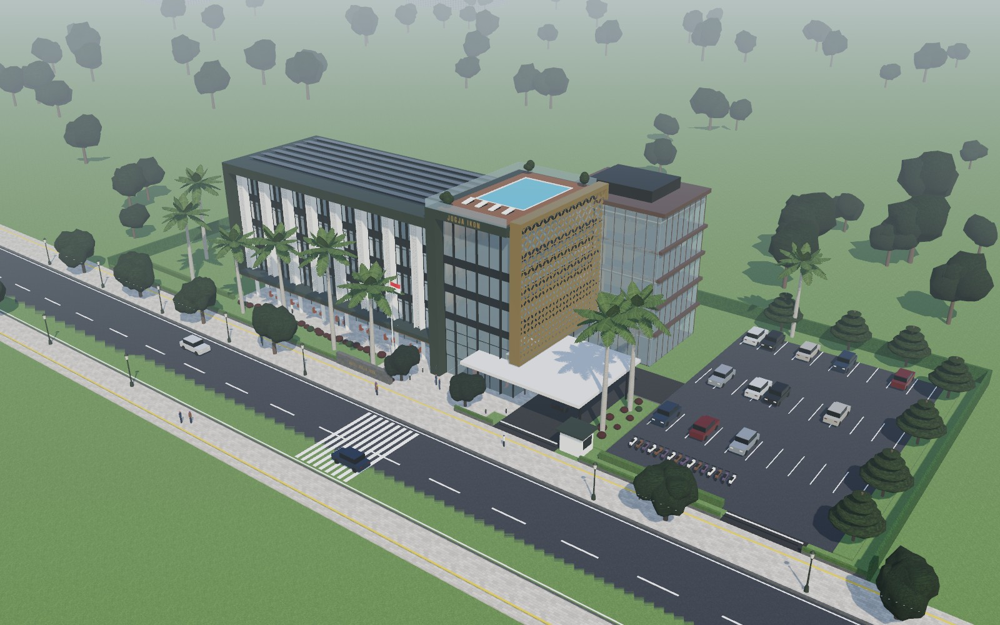
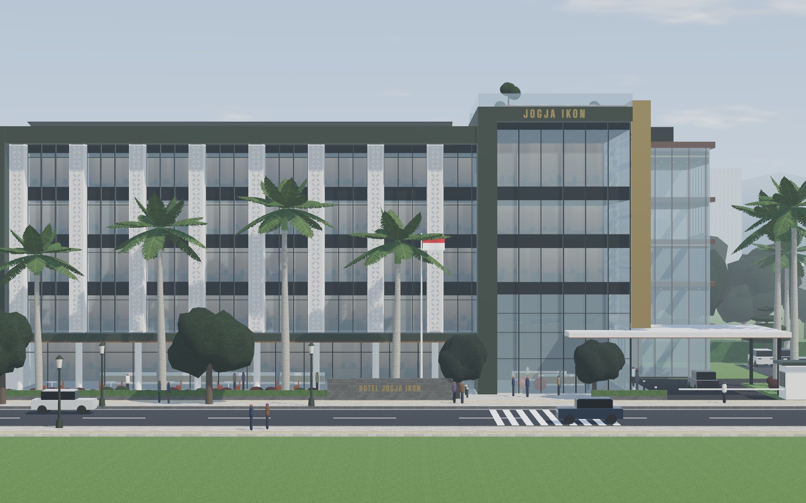
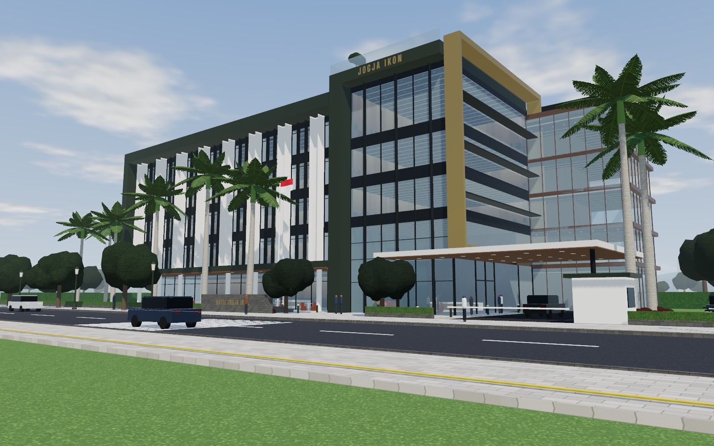

# Hotel Jogja Ikon, Konsep Kawung

Konsep arsitektur 3D untuk hotel tropis modern di Yogyakarta. Bahasa arsitektur gambar referensi disusun ulang menjadi model 3D yang utuh: massa asimetris, menara kaca tegak, kulit logam berlubang, bingkai atap yang tebal, porte-cochère, dan lansekap tropis. Hasilnya bukan salinan gambar 2D.

## Membuka model

Buka `index.html` di browser modern (Chrome, Edge, Firefox, Safari). Model dibangun secara prosedural dengan Three.js r169 yang dimuat dari jsDelivr, jadi perlu koneksi internet. Tidak ada langkah build.

- **Waktu:** Siang, Senja, Malam. Langit, matahari, lampu kamar, lampu taman, papan nama, kolam, dan cahaya sorot kulit kawung berubah bersama.
- **Kamera:** Sudut jalan, Drop-off, Selasar, Udara, Tampak depan. Seret untuk memutar, gulir untuk zoom.
- **Toggle:** Kulit kawung (tampilkan kaca di baliknya), Lansekap, Label (lantai dan elemen), Putar otomatis.
- **Catatan desain:** panel berisi gagasan, program ruang, tipe kamar, strategi iklim, sirkulasi, dan material.

## Gagasan

Tiga lapis yang terbaca dari jalan:

1. **Podium kaca** yang terbuka ke jalan: lobi dua lantai (8,4 m bersih), lobby lounge, dan restoran all-day dining dengan teras di selasar teduh sepanjang 40 m.
2. **Bingkai gelap** hijau zaitun yang memayungi empat lantai kamar, dengan overhang atap 2,4 m dan sirip perforasi putih pada modul 5,0 m.
3. **Kulit kawung** di sisi timur menara: panel aluminium champagne 19,2 × 18,0 m. Inilah "ikon" yang dimaksud nama hotel. Siang hari ia terlihat dari ujung jalan sebagai panel emas, malam hari ia menyala seperti lampion. Motifnya diambil dari batik kawung Yogyakarta (irisan buah aren). Bukaan perforasi bertahap dari ±18% di bawah hingga ±45% di puncak. Angka ini dihitung langsung dari pola yang dirender.

Massa asimetris dari referensi dipertahankan: sayap kamar yang panjang dan tenang, dipertemukan dengan menara sudut yang tegak sebagai penanda lobi dan porte-cochère. Mahkota menara membawa papan nama "JOGJA IKON" yang menyala pada malam hari, dengan kolam renang atap dan sky lounge di baliknya.

## Program per lantai

| Elevasi | Isi |
|---|---|
| ±0,00 | Lobi dua lantai dan resepsionis, lobby lounge, restoran all-day dining dengan teras di selasar |
| +5,00 | Ruang meeting dan pre-function di sisi jalan, 8 kamar Deluxe di sisi utara |
| +9,00 | 16 kamar Deluxe, 3 suite di menara |
| +13,00 | 16 kamar Deluxe, 3 suite di menara |
| +17,00 | 16 kamar Deluxe, sky lounge setinggi 5,8 m di menara menghadap Merapi |
| Atap | Kolam renang dan dek kayu di atas menara, ±440 m² panel surya (±85 kWp) di atas sayap kamar |
| Blok belakang | Inti lift dan tangga, dapur, laundry, gudang, ruang karyawan, spa dan gym |

Total ±62 kamar (56 Deluxe dan 6 Suite), luas lantai kotor ±4.850 m², puncak ±24,6 m.

## Kamar

- Deluxe ±32 m² pada modul fasad 5,0 m, koridor tengah, jendela kaca dari lantai ke plafon.
- Sirip kawung putih di antara jendela menjaga privasi dari jalan dan membayangi kaca.
- Suite ±55 m² di menara, dinding kaca penuh di sisi selatan dan timur, dengan kulit kawung sebagai tirai luar.

## Iklim, sirkulasi, lansekap

- Fasad panjang menghadap utara dan selatan. Sisi timur ditutup kulit kawung, sisi barat oleh dinding bingkai yang masif.
- Kendaraan tamu satu arah: masuk lewat pos keamanan, turun di porte-cochère 12,6 × 14,5 m, lalu valet atau parkir timur, keluar lewat gerbang terpisah. Lantai porte-cochère rata dengan lobi.
- Servis dan bongkar muat masuk ke blok belakang, terpisah dari jalur tamu. Pejalan kaki masuk lewat gerbang plaza sendiri. Trotoar menerus dengan ubin pemandu kuning dan zebra cross.
- Pagar depan rendah (±0,9 m) agar restoran dan lobi terlihat dan mengundang dari jalan.
- Palem raja di halaman depan, sepasang sawo kecik mengapit gerbang pejalan kaki, tanjung sebagai pohon jalan, ketapang kencana di parkir, pagar pucuk merah, dinding hijau di batas lahan.
- Air hujan atap ke tandon bawah tanah, lubang biopori di area hijau, paving berpori di parkir, kaca low-E, LED dengan sensor cahaya siang.

## Material

| Elemen | Material |
|---|---|
| Bingkai | Aluminium komposit hijau zaitun gelap |
| Kulit kawung | Aluminium anodized champagne, perforasi CNC |
| Sirip fasad | Aluminium perforasi putih |
| Kaca | Laminated low-E, tint netral |
| Plaza, dinding nama hotel | Batu andesit |
| Plafon selasar dan porte-cochère, dinding lobi, dek kolam | Kayu jati |
| Interior (dari referensi kedua) | Lacquer hitam, putih doff berpanel anyaman kuningan, kursi oranye bata, lampu gantung drum |

## Render

| | |
|---|---|
|  |  |
| Siang, sudut jalan | Malam, sudut jalan |
|  |  |
| Porte-cochère dan lobi, malam | Teras restoran di selasar, senja |
|  |  |
| Udara, siang (kolam atap di menara) | Tampak depan |
|  | |
| Kulit kawung dilepas, kaca suite terlihat | |

Render diambil dari model yang sama (Chromium headless, SwiftShader), jadi kualitasnya setara tampilan di browser, bukan render fotorealistik.

## Catatan

Ini model konsep berskala. Jumlah kamar, luas, dan dimensi bersifat indikatif dan perlu diverifikasi terhadap KDB, KLB, GSB, peraturan daerah setempat, dan standar operator hotel sebelum pengembangan desain. Papan nama final sebaiknya disertai aksara Jawa sesuai kebiasaan penanda bangunan di Yogyakarta.
