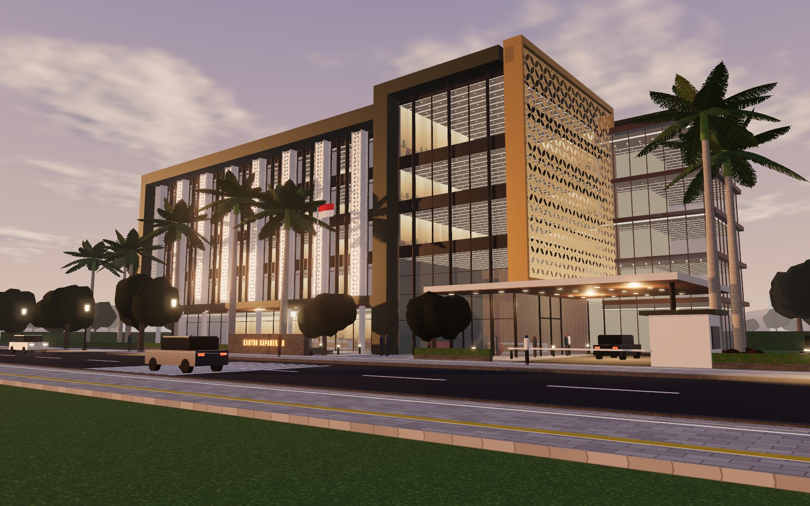
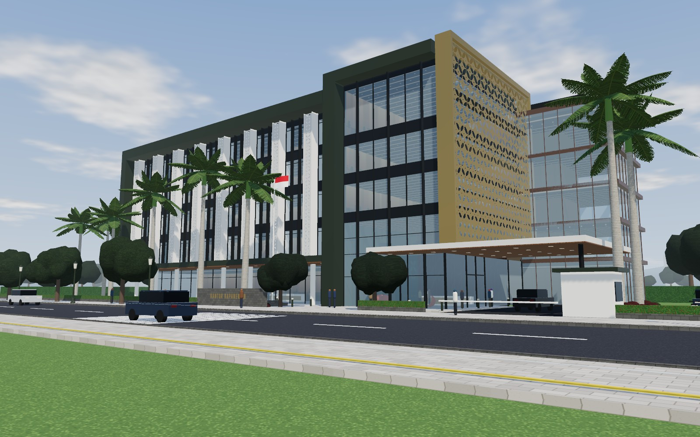
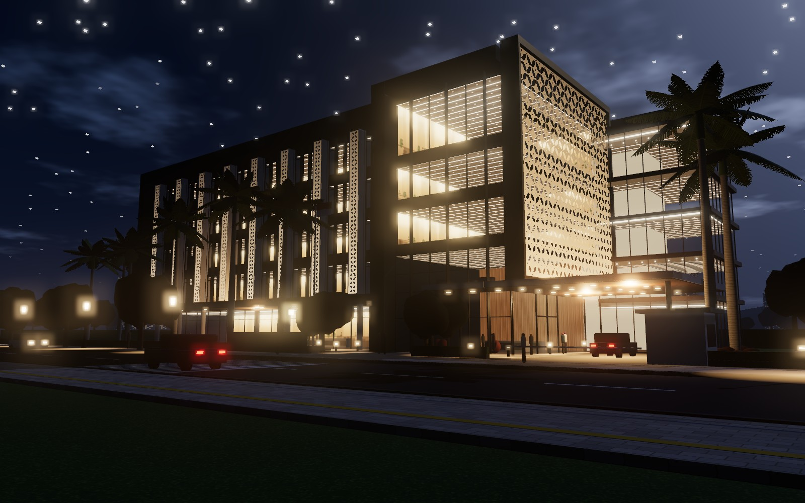
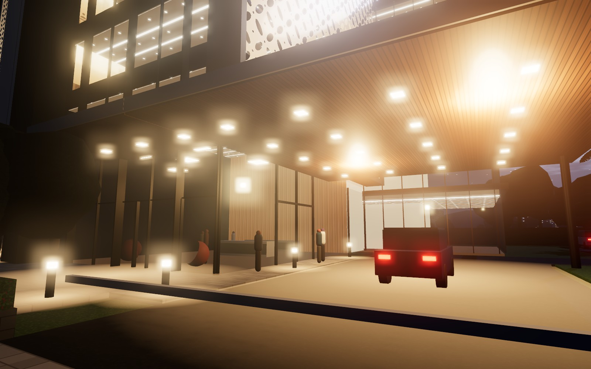
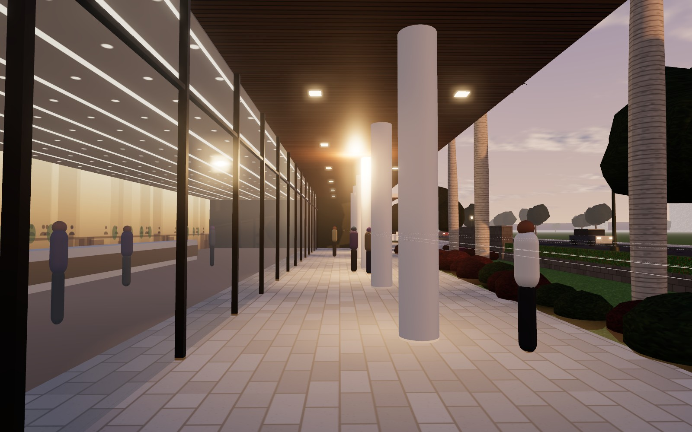
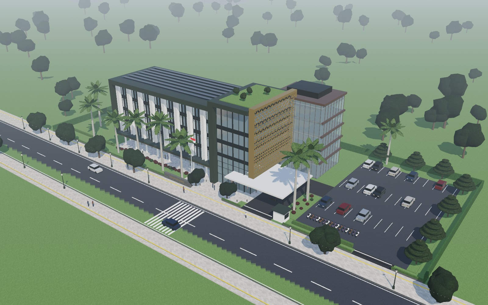
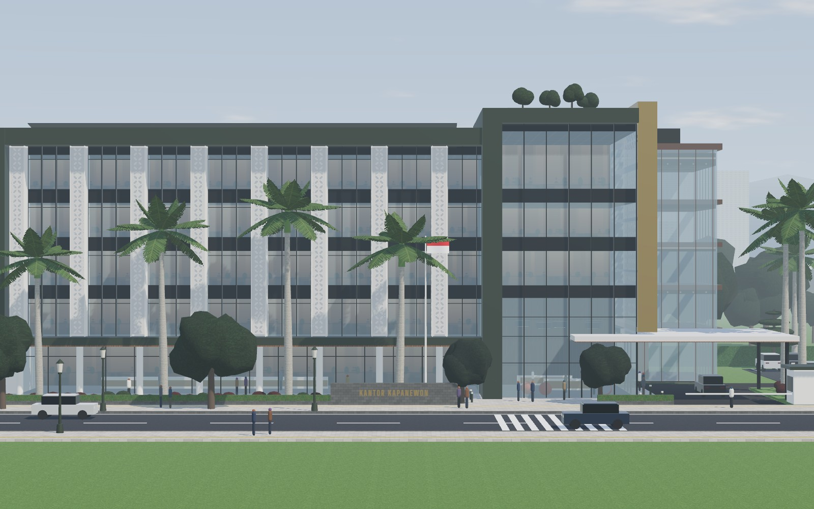
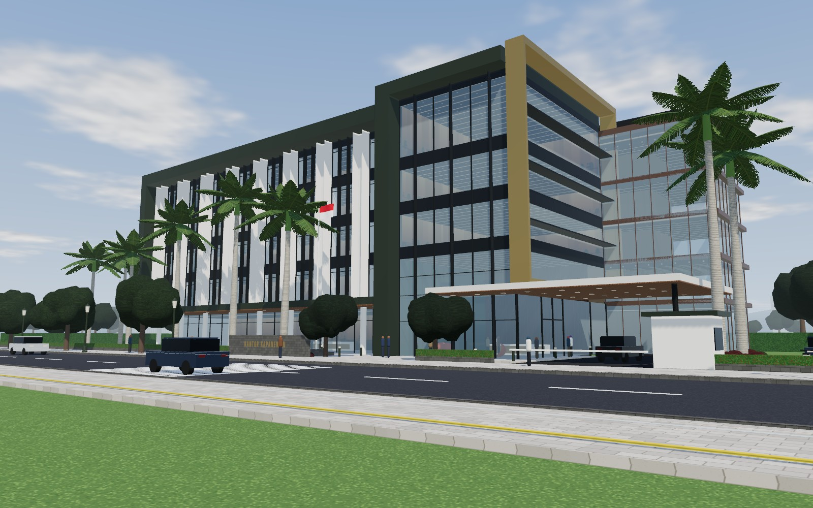

# Kantor Kapanewon, Konsep Kawung

Konsep arsitektur 3D untuk kantor pemerintahan tingkat kapanewon (DIY) bergaya tropis modern. Bahasa arsitektur gambar referensi disusun ulang menjadi model 3D yang utuh: massa asimetris, menara kaca tegak, kulit logam berlubang, bingkai atap yang tebal, dan lansekap tropis. Hasilnya bukan salinan gambar 2D.

## Membuka model

Buka `index.html` di browser modern (Chrome, Edge, Firefox, Safari). Model dibangun secara prosedural dengan Three.js r169 yang dimuat dari jsDelivr, jadi perlu koneksi internet. Tidak ada langkah build.

- **Waktu:** Siang, Senja, Malam. Langit, matahari, lampu interior, lampu taman, dan cahaya sorot kulit kawung berubah bersama.
- **Kamera:** Sudut jalan, Drop-off, Selasar, Udara, Tampak depan. Seret untuk memutar, gulir untuk zoom.
- **Toggle:** Kulit kawung (tampilkan kaca di baliknya), Lansekap, Label (lantai dan elemen), Putar otomatis.
- **Catatan desain:** panel berisi gagasan, program ruang, strategi iklim, sirkulasi, dan material.

## Gagasan

Tiga lapis yang terbaca dari jalan:

1. **Podium kaca** yang terbuka bagi warga: lobi dua lantai (8,4 m bersih) dan aula pelayanan terpadu di balik selasar teduh sepanjang 40 m.
2. **Bingkai gelap** hijau zaitun yang memayungi empat lantai kantor, dengan overhang atap 2,4 m dan sirip perforasi putih pada modul 5,0 m.
3. **Kulit kawung** di sisi timur menara: panel aluminium champagne 19,2 × 18,0 m yang motifnya diambil dari batik kawung Yogyakarta (irisan buah aren). Bukaan perforasi bertahap dari ±18% di bawah hingga ±45% di puncak. Angka ini dihitung langsung dari pola yang dirender.

Massa asimetris dari referensi dipertahankan: batang kantor yang panjang dan tenang, dipertemukan dengan menara sudut yang tegak sebagai penanda lobi dan kanopi drop-off. Blok servis kaca dengan garis lantai perunggu berada di belakang.

## Program per lantai

| Elevasi | Isi |
|---|---|
| ±0,00 | Lobi dua lantai, aula pelayanan terpadu dengan loket, ruang tunggu, ruang laktasi |
| +5,00 | Ruang Panewu dan Panewu Anom, sekretariat, ruang tamu |
| +9,00 | Ruang jawatan dalam kantor terbuka |
| +13,00 | Ruang rapat, arsip, ruang data dan CCTV |
| +17,00 | Balai pertemuan setinggi 5,8 m di menara, mushola, teras atap |
| Atap | ±440 m² panel surya (±85 kWp), taman atap menghadap Merapi |

Luas lantai kotor ±4.850 m², puncak ±24,6 m.

## Iklim, sirkulasi, lansekap

- Fasad panjang menghadap utara dan selatan. Sisi timur ditutup kulit kawung, sisi barat oleh dinding bingkai yang masif.
- Kendaraan satu arah: masuk lewat pos jaga, turun di bawah kanopi 12,6 × 14,5 m, lanjut ke parkir timur, keluar lewat gerbang terpisah. Pejalan kaki masuk lewat gerbang plaza sendiri. Trotoar menerus dengan ubin pemandu kuning dan zebra cross.
- Pagar depan rendah (±0,9 m) agar kantor terasa terbuka bagi warga. Tiang bendera Merah Putih di plaza untuk upacara.
- Palem raja di halaman depan, sepasang sawo kecik mengapit gerbang pejalan kaki, tanjung sebagai pohon jalan, ketapang kencana di parkir, pagar pucuk merah, dinding hijau di batas lahan.
- Air hujan atap ke tandon bawah tanah, lubang biopori di area hijau, paving berpori di parkir, kaca low-E, LED dengan sensor cahaya siang.

## Material

| Elemen | Material |
|---|---|
| Bingkai | Aluminium komposit hijau zaitun gelap |
| Kulit kawung | Aluminium anodized champagne, perforasi CNC |
| Sirip fasad | Aluminium perforasi putih |
| Kaca | Laminated low-E, tint netral |
| Plaza, dinding nama | Batu andesit |
| Plafon selasar dan kanopi, dinding lobi | Kayu jati |
| Interior (dari referensi kedua) | Lacquer hitam, putih doff berpanel anyaman kuningan, aksen oranye bata, lampu gantung drum |

## Render

| | |
|---|---|
|  |  |
| Siang, sudut jalan | Malam, sudut jalan |
|  |  |
| Drop-off dan lobi, malam | Selasar, senja |
|  |  |
| Udara, siang | Tampak depan |
|  | |
| Kulit kawung dilepas, kaca menara terlihat | |

Render diambil dari model yang sama (Chromium headless, SwiftShader), jadi kualitasnya setara tampilan di browser, bukan render fotorealistik.

## Catatan

Ini model konsep berskala. Dimensi bersifat indikatif dan perlu diverifikasi terhadap KDB, KLB, GSB, dan peraturan daerah setempat sebelum pengembangan desain. Papan nama final sebaiknya disertai aksara Jawa sesuai kebiasaan penanda gedung pemerintahan di DIY.
